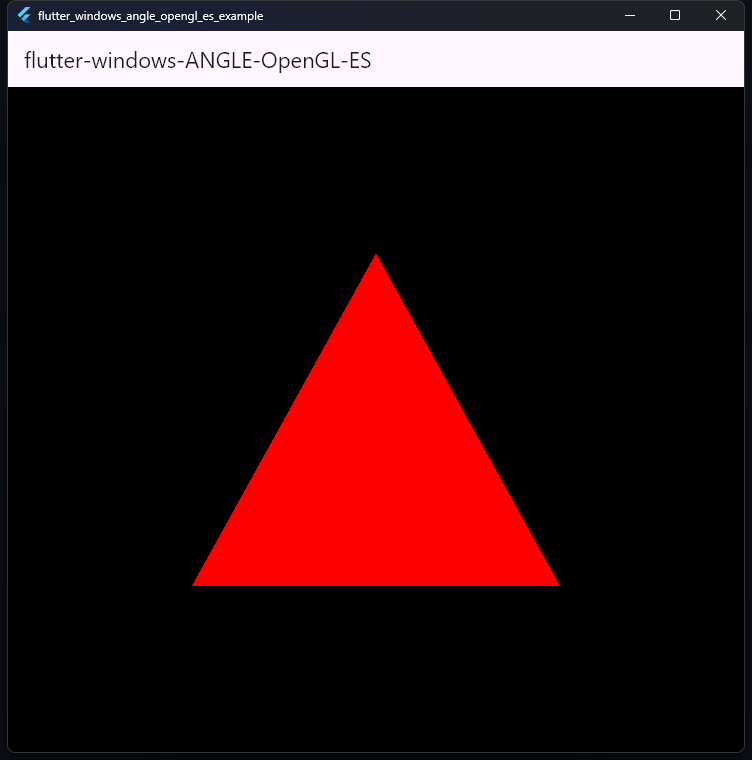

# flutter-windows-ANGLE-OpenGL-ES

OpenGL ES rendering in a Flutter Windows `Texture` widget using ANGLE.



## Introduction

[ANGLE (Almost Native Graphics Layer Engine)](https://github.com/google/angle) is used in this example, which translates these OpenGL ES calls to DirectX 11 (which Flutter Windows now supports) calls internally. The example uses the [new Direct3D texture interop capability for Flutter Windows](https://github.com/flutter/engine/pull/26840) added by [@jnschulze](https://github.com/jnschulze).

The x64 and ARM64 binaries are compiled and validated by
[GitHub Actions](.github/workflows/build-angle.yml) from the pinned
[ANGLE configuration](config/angle.lock.json). The plugin loads them from
`windows/bin/<architecture>`.

The package works with the latest stable Flutter 3.44.8 and requires Dart
`^3.12.0`.

## Build ANGLE

The build uses the pinned ANGLE revision and GN arguments in
[config/angle.lock.json](config/angle.lock.json). Build, validate, and package
an architecture with:

```cmd
python scripts\windows\angle.py setup
python scripts\windows\angle.py build x64
python scripts\windows\angle.py collect x64
python scripts\windows\angle.py verify x64
python scripts\windows\angle.py smoke build x64
python scripts\windows\angle.py smoke run x64
python scripts\windows\angle.py package x64
```

Use `arm64` instead of `x64` for the cross-build. Its runtime smoke test runs
on native Windows ARM64. Build progress is written to
`.angle-work/logs/build-<architecture>.log` and can be inspected with
`python scripts\windows\angle.py status <architecture>`. On Windows,
`scripts\windows\angle.cmd` is an optional shortcut for the same commands.

## Release archives

The workflow creates `ANGLE-windows-x64.zip`,
`ANGLE-windows-arm64.zip`, and `SHA256SUMS.txt`. Each archive contains the
verified ANGLE binaries, headers, SwiftShader, Vulkan loader, and build
manifest.

## Acknowledgements and references

- [@jnschulze](https://github.com/jnschulze) for
  [Direct3D texture interoperability support](https://github.com/flutter/engine/pull/26840).
- [ANGLE HelloTriangle.cpp](https://github.com/google/angle/blob/main/samples/hello_triangle/HelloTriangle.cpp).
- [Interop with other DirectX code](https://github.com/Microsoft/angle/wiki/Interop-with-other-DirectX-code).
- [A common OpenGL renderer for UWP and Win32 using ANGLE](https://clarkezone.net/posts/angle/).
